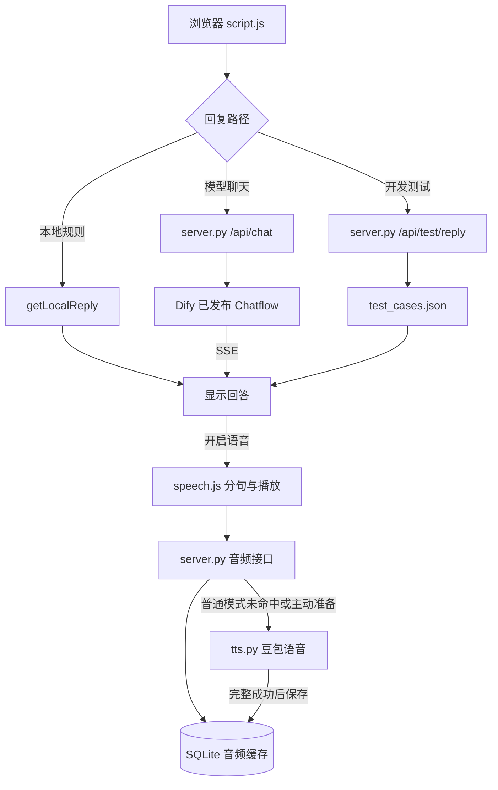

# 架构与实现

适用范围：当前原生网页 + Python 标准库后端。接口字段以 [API](API.md) 为准，功能成熟度与未实现能力见 [STATUS](STATUS.md)。

## 1. 模块与数据流

`server.py` 的 `LocalServer` 使用 `ThreadingHTTPServer`。网页和 API 同源，无前端构建步骤。图片和视频由静态允许列表提供。

`LivePortrait` 与 `RVM` 不在以上聊天链路中；它们提前生成素材，网页运行时只解码视频。

## 2. 回复路径与状态

`script.js` 的提交事件按以下优先级分支：

1. 开发测试开启：`showTestReply` 请求固定回答后直接返回。
2. 模型关闭：`getLocalReply` 在 JS 中即时回复。
3. 模型开启：`requestReply` 请求 Dify SSE。

开发测试优先于模型开关；测试期间模型开关与“开始新对话”被禁用，退出测试后保留原模型选择与会话编号。

| 状态 | 保存位置 | 作用与边界 |
| --- | --- | --- |
| 正在请求、停止意图、语音队列 | JS 内存 | 刷新后不保留 |
| `conversation_id` | JS 内存 + localStorage `dth.conversation.avatar` | 只保存编号，不保存可见历史消息 |
| 模型上下文 | Dify 云端会话 | Memory 是否生效取决于已发布画布 |
| 活动 `task_id` | 后端 `active_tasks` | 仅接受当前服务拥有的停止任务，结束即移除 |
| 测试回答 | `test_cases.json` | 不发送给 Dify，不推进模型会话 |
| 音频及访问元数据 | `data/cache.sqlite3` | 重启可复用；不随 Git 同步 |
| 两类服务密钥 | `local_config.py` | 启动时读取，仅后端使用 |

本地规则和开发测试记录可在页面抽屉里看到，但模型不知道这些内容。不同浏览器、端口、电脑的 localStorage 相互独立。

## 3. Dify 转发与停止

`make_dify_request` 共用云端请求配置：`inputs={}`、固定 `user=local-developer`、`auto_generate_name=False`；模型与提示词由 Dify 管理，不在网页指定。

`stream_reply` 读取上游 SSE，检查会话编号、任务编号及流程状态，只向网页转发必要的文字与控制事件。当前完成条件是收到 `message_end`、成功的 `workflow_finished`、有效会话编号和非空正文；断流不能当成功。

停止流程：

1. 点击“停止回答”先停止本机声音并冻结新增文字显示。
2. 尚无任务编号时记录停止意图，收到编号后再请求停止。
3. `/api/chat/stop` 仅允许当前后端持有的任务，按任务锁去重。
4. 收到 Dify 确认后标记停止；失败可重试，部分文字保留。
5. 若回答已自然完成，保留完整结果；旧停止响应不能污染下一轮。

停止确认不能撤回已经产生的 token；断开 HTTP 也不代表供应商计算已结束。当前没有请求级幂等键，故障后不自动重发问题。

## 4. 语音分句与播放

`SpeechParts` 处理标点、长句及基础 Markdown 清理；`ReplySpeech.split` 使用同一规则为完整测试台词生成分段。普通流式回答因到达节奏不同，可能触发额外的停顿切分。

| 参数 | 当前实现 |
| --- | --- |
| 短句合并 | 尽量到至少10字后选择句末边界；尾段可以更短 |
| 首段逗号切分 | 至少12字后的自然停顿 |
| 无合适边界的长段 | 首段约32字符，后续约60字符；不是所有富文本的硬上限 |
| 文字流停顿 | 450ms 后提交未完成尾段 |
| 待播队列 | 最多24段，过多则停止本轮语音 |
| 音频预取 | 上游串行合成，最多保留当前与下一段两项任务 |
| PCM | 24000Hz，单声道，16位有符号小端 |
| 播放缓冲 / 句间停顿 | 约120ms / 80ms |
| 空闲设备处理 | 开启语音时预热，空闲10秒后挂起；显式停止立即挂起 |

`ReplySpeech.consume` 同时供播放与准备按钮解析 NDJSON；必须得到合法 `start`、非空偶数字节音频以及 `done`。`AudioBufferSourceNode` 按同一个 AudioContext 时钟调度，避免对每块音频重新调用播放。

`epoch` 区分新旧轮次，`AbortController` 取消下载，任务自身校验阻止迟到回调。停止清理音频源和定时器。语音错误独立提示，不应阻断文字聊天。

## 5. 测试配置与准备计划

`load_cases` 每次从文件读取并校验：

- 顶层为1～30条案例的 JSON 数组，文件不超过65536字节。
- 每条仅包含 `id`、`inputs`、`reply`。
- `id` 为1～40个英文字母、数字、下划线或短横线，全局唯一。
- `inputs` 为1～20个别名，每个去首尾空格后1～500字，全文件不得重复。
- `reply` 去首尾空格后1～500字；开发测试使用普通文本，不含 Markdown。

`revision` 是配置内容的摘要。检查音频时，浏览器用 `ReplySpeech.split` 提交全部案例的分段；`test_audio_plan` 核对编号和完整台词，允许分段间空白差异，不能改变正文。

`plan_id` 同时包含台词版本、完整分段清单和当前合成参数。索引指向去重后的 `items`，不是原案例的序号。准备时重新核对计划，编辑台词或音色后旧计划失效。

检查只访问本机内容，并更新测试音频保护标记，不调用云端。生成按钮逐段请求，只补缺失；取消后已完成的缓存保留，没有自动重试。

## 6. 音频缓存

`speech_key` 对“去首尾空格后的实际朗读文字 + `audio_profile`”计算 SHA256。参数包含提供方、资源模型、音色、格式、采样率和 `cache_version`；密钥不参与编号。

处理顺序：

1. 先查 SQLite 并校验音频长度与 SHA256。
2. 命中：直接返回，不要求密钥，不占云端合成锁。
3. 测试入口未命中：返回错误；不使用云端兜底。
4. 普通入口未命中：检查密钥和合成锁，逐块返回上游音频。
5. 上游完整成功后事务保存，再发完成事件。中断、失败音频不入库。
6. 普通模式保存失败可继续播放并返回警告；主动准备未保存成功则报告失败。

数据库表 `audio`：

| 字段 | 内容 |
| --- | --- |
| `key` | 主键，音频请求摘要 |
| `text` / `profile` | 实际文字 / 参数 JSON |
| `audio` / `checksum` / `size` | 音频 BLOB / SHA256 / 字节数 |
| `created` / `used` / `hits` | 创建时间 / 最近使用时间 / 命中次数 |
| `pinned` | 当前测试计划保护标记 |

连接按操作创建并关闭，写入使用事务；并非共享一条跨线程 SQLite 连接。音频数据默认额度100MiB，按最近使用时间淘汰未保护项；单条不超过4MiB。检查计划会重设保护标记，过期台词可淘汰。额度不是数据库物理文件的精确上限，也没有后台自动 VACUUM。

数据库没有独立的表结构迁移系统。`cache_version` 用于音频结果失效；增加 SQL 字段需要另行设计兼容与迁移。

## 7. 人物、资源与使用边界

`GET /api/avatar` 每次重新检测固定素材，WebM 优先于 MP4；刷新后重新选择。已存在的其他允许类型素材在后端启动时登记，但网页人物仍只使用固定入口，详见 [素材说明](../png/README.md)。

后台或系统“减少动画”设置会暂停人物视频。切后台不等于停止 Dify 或语音；`pagehide` 会停止本机声音、准备下载和人物视频，但没有保证取消云端模型任务。

服务只供个人本机使用：无登录、无多人用户/会话隔离、无生产级并发或限流设计；固定 Dify user 不能直接用于多人产品。
